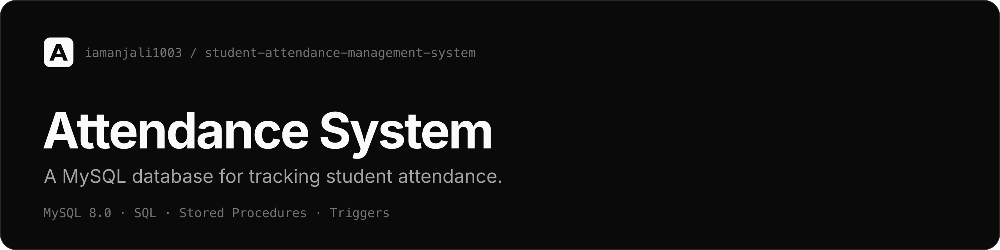
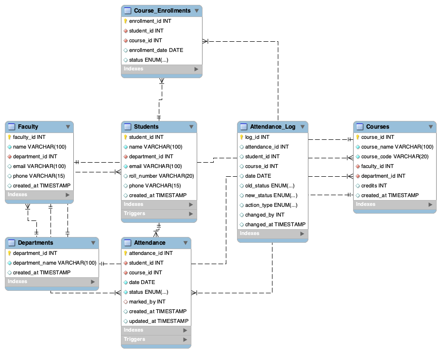

A MySQL database for tracking student attendance across departments, faculty and courses.

[Guide](docs/Guide.md) · [Schema diagram](docs/Diagram.md) · [Report](REPORT.md)

## Overview

Built as the mini project for the DBMS Lab course (BCS403). The schema is
normalised to third normal form, every change to attendance is logged by
triggers, and the common reports are stored procedures, so the database enforces
its own rules instead of trusting whatever application sits on top of it.

## Features

- Seven tables covering departments, faculty, students, courses, enrolments and attendance
- Daily attendance with a `Present`, `Absent` or `Late` status
- One mark per student, course and day, enforced by a composite unique key
- An audit log written by triggers on every insert, update and delete
- Attendance can't be marked for a future date; a trigger rejects it
- Six stored procedures for reports, bulk marking and finding low attendance
- Indexes on every foreign key used in joins

## Tech stack

| Area | Choice |
| --- | --- |
| Database | MySQL 8.0 |
| Language | SQL |
| Logic | Stored procedures and triggers |
| Tooling | MySQL Workbench (optional) |

## How it works

```
   Departments ──1:M──> Faculty ──1:M──> Courses
        │                                   │
       1:M                                 1:M
        v                                   v
    Students ──M:M (Course_Enrollments)──> Courses
        │                                   │
       1:M                                 1:M
        └───────────────> Attendance <──────┘
                              │
                 triggers on insert, update, delete
                              v
                        Attendance_Log
```



**Triggers**

| Trigger | When | What it does |
| --- | --- | --- |
| `attendance_insert_log` | after insert on Attendance | logs the new mark |
| `attendance_update_log` | after update on Attendance | logs the old and new status |
| `attendance_delete_log` | after delete on Attendance | logs the removed mark |
| `student_delete_log` | before delete on Students | logs the student's records before they go |
| `validate_attendance_date` | before insert on Attendance | rejects a date in the future |
| `update_attendance_timestamp` | before update on Attendance | keeps `updated_at` current |

**Stored procedures**

| Procedure | What it does |
| --- | --- |
| `CalculateAttendancePercentage` | a student's attendance percentage in a course |
| `GetStudentAttendanceReport` | every course and percentage for one student |
| `AutoMarkAbsent` | marks unmarked students absent for a course and date |
| `GetCourseAttendanceSummary` | present, absent and late counts for a course on a date |
| `BulkMarkAttendance` | marks a comma-separated list of students in one call |
| `GetLowAttendanceStudents` | students below a percentage threshold |

## Getting started

Needs MySQL Server 8.0 or later.

```bash
git clone https://github.com/iamanjali1003/student-attendance-management-system.git
cd student-attendance-management-system
mysql -u root -p
```

Then, from the MySQL prompt in the repository folder:

```sql
SOURCE setup.sql;
USE student_attendance_db;
SHOW TABLES;
```

`setup.sql` creates the database, then loads the schema, triggers, procedures
and sample data in that order.

## Usage

```sql
-- mark attendance
INSERT INTO Attendance (student_id, course_id, date, status, marked_by)
VALUES (1, 1, CURRENT_DATE, 'Present', 1);

-- one student's report
CALL GetStudentAttendanceReport(1);

-- everyone under 75%
CALL GetLowAttendanceStudents(75.00);
```

More examples are in `queries/crud_operations.sql` and `queries/test_queries.sql`.

## Project structure

```
.
├── setup.sql                 runs everything below, in order
├── database/
│   ├── schema.sql            tables, keys and indexes
│   ├── triggers.sql          audit log, validation, timestamps
│   ├── procedures.sql        the six stored procedures
│   └── sample_data.sql       a small dataset to try it with
├── queries/
│   ├── crud_operations.sql
│   └── test_queries.sql
├── docs/
│   ├── Guide.md              full walkthrough
│   └── Diagram.md
├── er.png                    entity-relationship diagram
└── REPORT.md                 the course report
```

## License

[MIT](LICENSE) © 2025 [Anjali](https://iamanjali1003.github.io)
